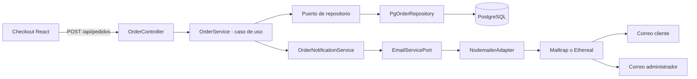

# Actividad 2.5 - Notificaciones por correo

## Arquitectura incorporada



El núcleo depende del contrato `EmailServicePort`. Nodemailer solo aparece en infraestructura, como adaptador de salida. Tras persistir el pedido, `OrderService` consulta el pedido completo y solicita al servicio de notificaciones el correo al cliente y al administrador. Un fallo SMTP no revierte una orden ya confirmada en PostgreSQL; el API responde `notification.status: FAILED` para que se pueda revisar la configuración.

## Estado y migración

Los pedidos nuevos se crean en `PENDIENTE_DE_PAGO`, que la interfaz muestra como **Pendiente de Pago**. Antes de desplegar, ejecutar una sola vez `database/migrations/002_pendiente_de_pago.sql` en la base del entorno. La migración no contiene secretos, hosts ni recursos de AWS.

## Configuración de correo

Copiar `.env.example` a `.env` y completar las variables SMTP. Para Mailtrap, usar sus datos SMTP. Para una prueba desechable, configurar `EMAIL_PROVIDER=ethereal`; el adaptador solicita una cuenta de prueba a Ethereal en el primer envío. Nunca versionar `.env`, claves SMTP ni credenciales de AWS.

## Verificación

```bash
npm install
npm test
cd frontend && npm install && npm run build
```

Las pruebas incluidas validan que se solicita la notificación para el pedido y que una caída SMTP no borra una orden ya registrada. Para capturas de Mailtrap/Ethereal, configurar un buzón de prueba, crear una orden desde Checkout y capturar la bandeja y la URL de vista previa resultante. No se adjuntan capturas inventadas: no se ejecutó una entrega real sin credenciales SMTP del entorno.

## Código fuente

Repositorio: https://github.com/Jaredcito-opsSoft/Taller3M

Rama de trabajo: `actividad-2.5-notificaciones`
