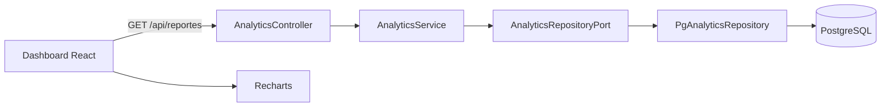

# Actividad 2.6 - Dashboard de métricas y reportes analíticos

## Objetivo

El sistema incorpora un subsistema de consultas analíticas para que un administrador pueda revisar ingresos confirmados, ticket promedio, distribución de estados y productos con mayor rotación. Las agregaciones se ejecutan en PostgreSQL y no cargan el historial completo en memoria de Node.js.

## Arquitectura hexagonal



- `AnalyticsService`: puerto de entrada/caso de uso. Valida fechas, agrupación y límite del ranking; coordina las proyecciones del reporte.
- `AnalyticsRepositoryPort`: contrato de salida independiente de PostgreSQL.
- `PgAnalyticsRepository`: adaptador SQL con `SUM`, `COUNT`, `AVG`, `GROUP BY`, `DATE_TRUNC` y filtros por fecha.
- `AnalyticsController`: adaptador HTTP.
- `JwtTokenAdapter`: adaptador de infraestructura que firma y valida JWT. El endpoint de reportes exige un usuario autenticado con rol `ADMIN`.
- `AnalyticsDashboard`: vista React exclusiva para administradores; Recharts solo conoce las proyecciones devueltas por la API.

## Especificación del endpoint

### `GET /api/reportes`

Devuelve todas las métricas necesarias para el dashboard en una sola solicitud.

**Autorización**

```http
Authorization: Bearer <token-jwt-del-administrador>
```

**Parámetros de consulta**

| Parámetro | Tipo | Requerido | Descripción |
| --- | --- | --- | --- |
| `desde` | `AAAA-MM-DD` | No | Inicio inclusivo. Por defecto, 29 días antes de hoy. |
| `hasta` | `AAAA-MM-DD` | No | Fin inclusivo. Por defecto, hoy. |
| `agrupacion` | `dia`, `semana`, `mes` | No | Unidad de la tendencia. Por defecto, `dia`. |
| `limite` | entero 1–10 | No | Número de productos en el ranking. Por defecto, 5. |

**Ejemplo**

```bash
curl "http://localhost:3000/api/reportes?desde=2026-10-01&hasta=2026-10-09&agrupacion=dia&limite=5" \
  -H "Authorization: Bearer TOKEN_DEL_ADMIN"
```

**Respuesta `200 OK`**

```json
{
  "filters": {
    "desde": "2026-10-01",
    "hasta": "2026-10-09",
    "agrupacion": "dia",
    "limite": 5
  },
  "summary": {
    "ingresos_totales": 18450,
    "pedidos_totales": 12,
    "pedidos_pendientes": 3,
    "ticket_promedio_pedido": 2306.25,
    "ticket_promedio_usuario": 3690,
    "clientes_activos": 7
  },
  "revenueTrend": [
    { "periodo": "2026-10-01", "ingresos": 4200, "pedidos": 2 }
  ],
  "orderStatuses": [
    { "estado": "PENDIENTE_DE_PAGO", "cantidad": 3, "porcentaje": 25 },
    { "estado": "PAGADO", "cantidad": 5, "porcentaje": 41.67 },
    { "estado": "ENVIADO", "cantidad": 3, "porcentaje": 25 },
    { "estado": "CANCELADO", "cantidad": 1, "porcentaje": 8.33 }
  ],
  "topProducts": [
    {
      "producto_id": 4,
      "producto_nombre": "Teclado mecánico",
      "unidades_vendidas": 8,
      "monto_recaudado": 7200
    }
  ],
  "generatedAt": "2026-10-09T18:30:00.000Z"
}
```

**Errores**

- `400`: fecha, agrupación o límite inválido.
- `401`: token ausente, inválido o expirado.
- `403`: usuario autenticado sin rol `ADMIN`.

## Criterio de las métricas

- **Ingresos**: suma pedidos con estado `PAGADO` o `ENVIADO`; no considera pendientes ni cancelados.
- **Ticket por pedido**: promedio de los pedidos `PAGADO` o `ENVIADO`.
- **Ticket por usuario**: ingreso confirmado dividido entre compradores únicos con pedidos confirmados.
- **Estados**: contempla todos los pedidos del periodo, incluidos pendientes y cancelados.
- **Top productos**: unidades y monto de ítems pertenecientes a pedidos `PAGADO` o `ENVIADO`.

## Instalación y ejecución

1. Añadir un secreto largo al `.env`:

   ```env
   JWT_SECRET=un_secreto_largo_y_aleatorio_solo_para_este_entorno
   ```

2. Aplicar las migraciones en orden:

   ```bash
   psql -h localhost -U postgres -d ecommerce_db -f database/migrations/002_pendiente_de_pago.sql
   psql -h localhost -U postgres -d ecommerce_db -f database/migrations/003_estado_enviado_analytics.sql
   ```

3. Instalar y ejecutar:

   ```bash
   npm install
   npm test
   npm run dev
   ```

   En otra terminal:

   ```bash
   cd frontend
   npm install
   npm run dev
   ```

4. Cerrar la sesión anterior e iniciar sesión otra vez como administrador para recibir un token JWT. La pestaña **Dashboard** será la vista inicial del administrador.

## Evidencias para anexar

Insertar debajo de cada captura una descripción como las siguientes:

1. **Dashboard general:** “Panel administrativo con ingresos confirmados, volumen de pedidos y tickets promedio para los últimos 30 días.”
2. **Tendencia y estados:** “Gráficos interactivos de ingresos por día y distribución porcentual de pedidos por estado.”
3. **Ranking de productos:** “Top 5 de productos ordenados por unidades vendidas y monto recaudado.”
4. **Filtro de fechas:** “Dashboard recalculado para un rango personalizado y agrupación semanal.”
5. **Control de acceso:** “La API rechaza con HTTP 403 el acceso de un usuario con rol CLIENTE.”

## Archivos principales

- `src/application/analyticsService.js`
- `src/application/ports/AnalyticsRepositoryPort.js`
- `src/infrastructure/repositories/pgAnalyticsRepository.js`
- `src/interfaces/analyticsController.js`
- `src/infrastructure/auth/JwtTokenAdapter.js`
- `frontend/src/modules/analytics/`
- `database/migrations/003_estado_enviado_analytics.sql`
- `test/analyticsService.test.js`
- `test/jwtTokenAdapter.test.js`

## Validación

```bash
npm test
npm --prefix frontend run lint
npm --prefix frontend run build
```

Las pruebas cubren la normalización y validación de filtros, la coordinación del caso de uso analítico, la firma/verificación JWT y la denegación del endpoint para clientes.
